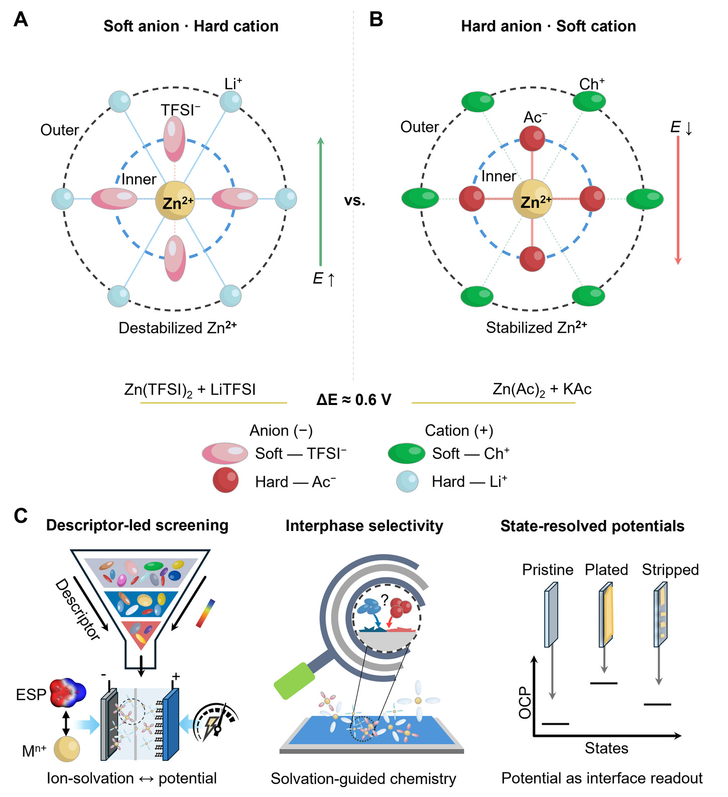

{: style="max-width:520px;margin-inline:auto;"}

This Preview discusses how ion hardness and softness in the inner and outer coordination shells work together to shift metal electrode potentials.

Author-created schematic for [Jin et al., *Chem* 12(11) (2026), 103321, Fig. 1](https://doi.org/10.1016/j.chempr.2026.103321).
